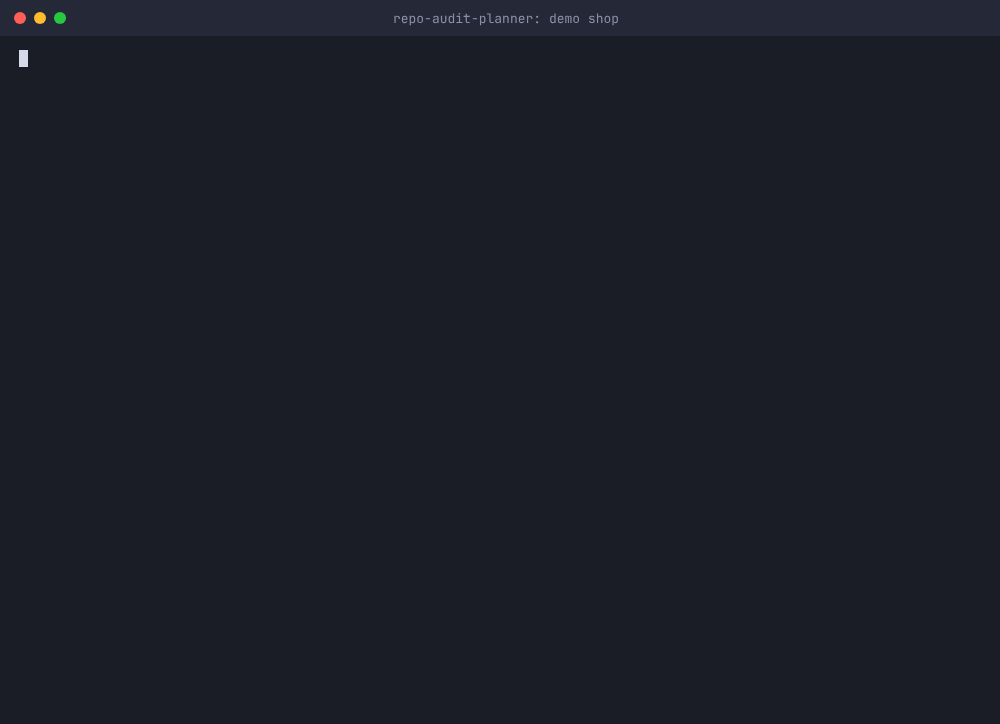
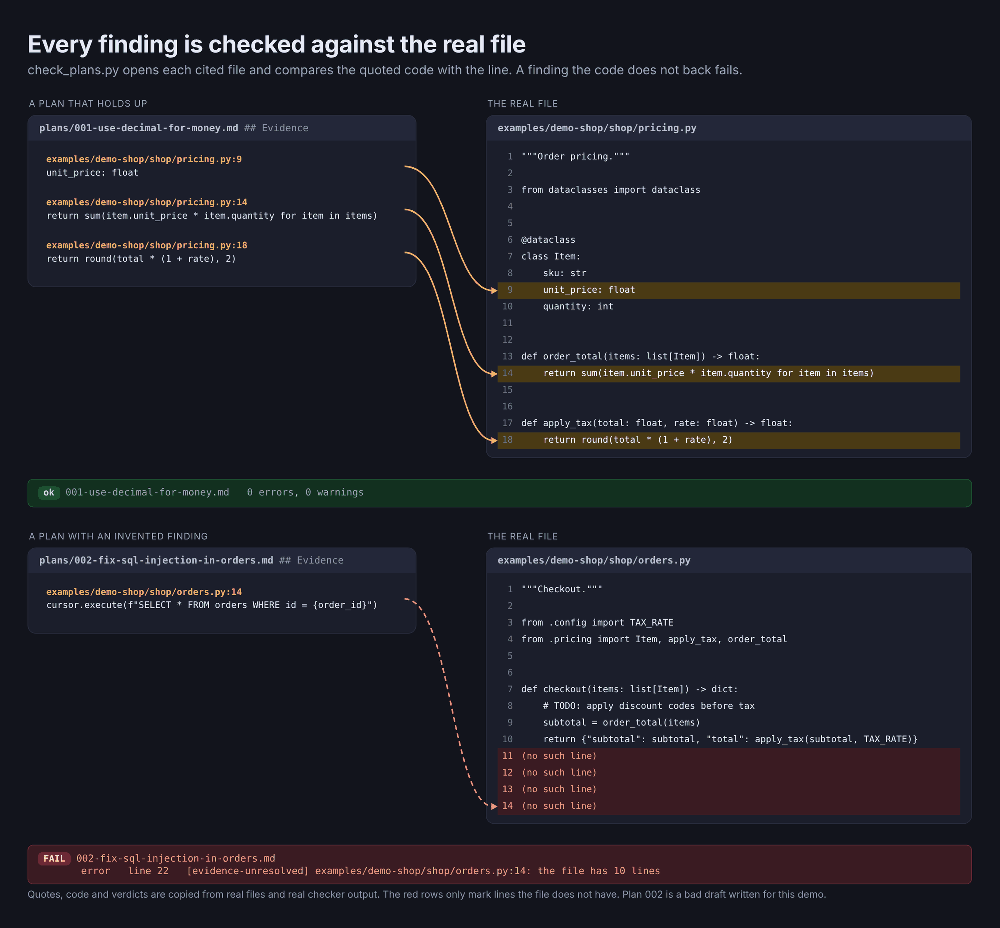
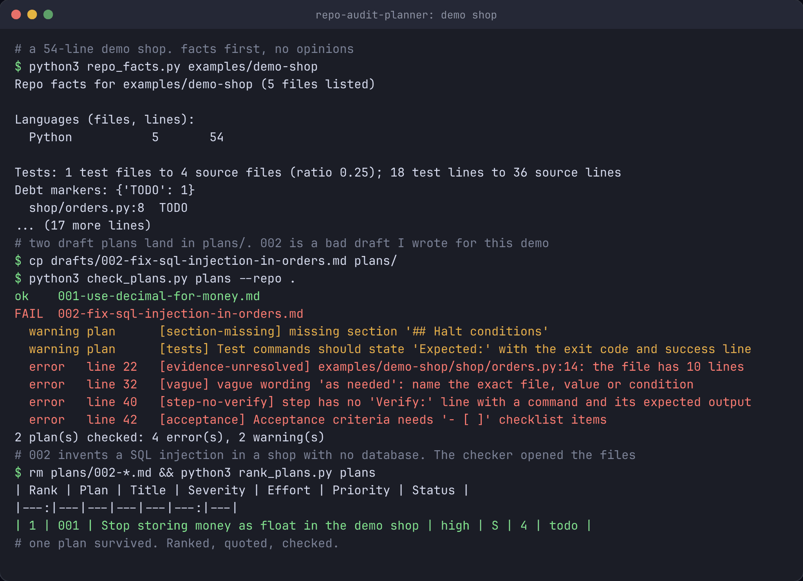
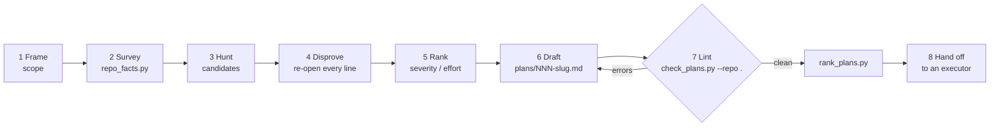

<p align="center"></p>
<h1 align="center">Repo Audit Planner</h1>
<p align="center"><b>Your best model audits the repo. A cheaper one fixes it. A checker proves the audit is not made up.</b></p>
<p align="center">
<a href="https://github.com/FinnTech3/repo-audit-planner/actions/workflows/ci.yml"></a>


</p>
<p align="center"></p>

## The straight answer

- **What it does.** Makes your AI agent audit a codebase and write one plan file per problem: goal, quoted evidence, exact steps with a check after each, acceptance criteria and a rollback. A cheaper model, or a new hire, can carry a plan out without asking a question.
- **What it needs.** Python 3.10 or newer and nothing else. Three single-file scripts, standard library only, no network, no install. `git` is optional.
- **What it will not do.** Change your code. It writes under `plans/` only, and the skill tells the agent to refuse even a one-line fix. It also cannot tell you a fix is the right one, only that the plan is complete and its evidence is real.

The problem it solves is dull and common. Ask a model to "audit this repo" and you get confident findings, some invented. Hand vague plans to a cheaper model and it improvises. Here every finding must quote the line it is about, and `check_plans.py` opens the file and compares.

## See it work



*Top: a plan whose three quotes sit on the lines it cites. Bottom: a plan that invents a SQL injection in a shop with no database. The checker fails it before any executor sees it. Plan 002 is a bad draft I wrote for this demo.*



*The same run as the clip above, final frame. Real output; the repo facts are trimmed and say so.*

## Run it in 60 seconds

```bash
git clone https://github.com/FinnTech3/repo-audit-planner && cd repo-audit-planner
python3 agensi/repo-audit-planner/scripts/repo_facts.py examples/demo-shop
python3 agensi/repo-audit-planner/scripts/check_plans.py examples --repo .
python3 agensi/repo-audit-planner/scripts/rank_plans.py examples
```

The first lines of the facts (the full output is in [sample-repo-facts.txt](agensi/repo-audit-planner/examples/sample-repo-facts.txt)):

```text
Repo facts for examples/demo-shop (5 files listed)

Languages (files, lines):
  Python           5       54

Tests: 1 test files to 4 source files (ratio 0.25); 18 test lines to 36 source lines
Debt markers: {'TODO': 1}
  shop/orders.py:8  TODO
```

The checker and the ranking print:

```text
ok    001-use-decimal-for-money.md
1 plan(s) checked: 0 error(s), 0 warning(s)

| Rank | Plan | Title | Severity | Effort | Priority | Status |
|---:|---|---|---|---|---:|---|
| 1 | 001 | Stop storing money as float in the demo shop | high | S | 4 | todo |
```

Now break it on purpose. This copies in the bad draft from the demo and exits with code 1:

```bash
cp docs/media-src/002-fix-sql-injection-in-orders.md examples/
python3 agensi/repo-audit-planner/scripts/check_plans.py examples --repo .
rm examples/002-fix-sql-injection-in-orders.md
```

## Use it with your agent

1. Install the skill from Agensi, or copy `agensi/repo-audit-planner/` from this repo into your agent's skills folder.
2. Ask: "Audit this repo and write plans for the top problems."
3. The agent runs `repo_facts.py`, hunts for problems, tries to disprove each one, ranks the survivors, and writes `plans/NNN-slug.md`.
4. It runs `check_plans.py --repo .` and fixes its own plans until the exit code is 0, then ranks them.
5. You get a hand-off: scope covered, ranked table, rejected candidates, baseline test output, and `git status` proving nothing outside `plans/` changed.

Hand a plan to an executor with: "Implement `plans/001-use-decimal-for-money.md`. Follow it exactly. Run each Verify line and halt at any halt condition."

What it costs you: a terminal, read access to the repo, write access to the `plans/` folder. Scripts reach the agent as text from Agensi and run from a temporary file. No network, no environment variables.

## How it works



Priority is `severity weight / effort weight` (critical 20, high 8, medium 3, low 1; XS 1, S 2, M 4, L 8, XL 16). Critical plans go first and a plan never ranks above one it depends on, so the order is reproducible, not a mood.

| A plan always has | Rule |
|---|---|
| Goal | An end state you can observe |
| Evidence | `path:line` plus the exact code, verified against the file |
| Steps | Each ends with a `Verify:` command and its expected output |
| Acceptance criteria | A checklist a machine can decide |
| Test commands, Halt conditions | Exact commands; when to stop instead of improvising |
| Risks and rollback | What could break, and the command that undoes it |

The template is [plan-template.md](agensi/repo-audit-planner/references/plan-template.md). A finished plan is [examples/001-use-decimal-for-money.md](examples/001-use-decimal-for-money.md).

<details><summary>Everything <code>check_plans.py</code> catches</summary>

| Problem | Level |
|---|---|
| No plan files in the folder, or a plan not named `NNN-slug.md` | error |
| Missing or invalid front matter, bad severity, effort or status, id that does not match the file name | error |
| Duplicate plan number, or `depends_on` naming a plan that does not exist | error |
| Missing or empty Goal, Evidence, Context, Scope, Steps, Acceptance criteria, Test commands, or Risks and rollback | error |
| Missing `In scope`, `Out of scope`, `Risks` or `Rollback` part | error |
| Unfilled `{{placeholder}}` | error |
| A step with no `Verify:` line, no checklist in Acceptance criteria, no fenced commands in Test commands | error |
| Vague wording in the goal, scope, steps, acceptance criteria or test commands ("as needed", "etc", "consider") | error |
| Evidence with no `path:line` reference | error |
| With `--repo`: cited file missing, path outside the repo, line past the end, no quoted code, or quote not on the cited line (`[REDACTED]` can stand in for a secret value) | error |
| Missing Halt conditions, or no `Expected:` line under Test commands | warning |
| With `--repo` and git: a cited file changed since the plan's `base_commit` | warning |

Exit codes: `0` all plans pass, `1` a plan has an error or no plans were found, `2` usage error.

</details>

<details><summary>What is in the box</summary>

| Path | Purpose |
|---|---|
| [`agensi/repo-audit-planner/SKILL.md`](agensi/repo-audit-planner/SKILL.md) | The workflow, severity rubric and plan standard the agent follows |
| [`scripts/repo_facts.py`](agensi/repo-audit-planner/scripts/repo_facts.py) | Languages, tests, debt markers, largest files, manifests, CI, secret-like locations, churn |
| [`scripts/check_plans.py`](agensi/repo-audit-planner/scripts/check_plans.py) | Validates plans; with `--repo`, compares every quote with the real file |
| [`scripts/rank_plans.py`](agensi/repo-audit-planner/scripts/rank_plans.py) | Ranks plans by severity against effort, respecting dependencies |
| [`examples/`](examples) | A finished plan and the demo shop it was written for |
| [`agensi/LISTING.md`](agensi/LISTING.md), [`TRIGGER_TESTS.md`](agensi/TRIGGER_TESTS.md) | Marketplace copy and the prompts for testing that the skill triggers |

</details>

## Why it's built this way

- **Quotes, not claims.** I made the evidence a quoted line because a model can describe a bug that is not there. It cannot quote one that is not there and pass a string match.
- **Strict on vagueness.** "Handle edge cases as needed" is where a cheaper model starts guessing. So hedges are errors, not style notes.
- **Facts script separate from the judging.** `repo_facts.py` reports and never opines. The model decides where to look, and I can test the script.
- **Three single files.** Agensi delivers text, and the agent writes each script to a temp file unchanged. So each one is standalone, standard library only, under 20 KB.
- **Read-only by construction.** No `shell=True`, no network, no following symlinks, capped file count, size and time. A secret-like line is reported by location and kind, never by value.

## What it won't do

- Judge whether a fix is the right fix. The checker proves a plan is complete, concrete and backed by real code. Plan quality follows the model you run.
- Find every secret. Detection is pattern-based and finds common shapes.
- Read everything. `repo_facts.py` stops at 20,000 files, 1 MB per file, or 20 seconds, says when it did, and skips `node_modules`, `vendor`, `dist`, `build`, `target`, `.venv` and similar even when committed.
- Prove it triggers in your agent. The ten prompts in [TRIGGER_TESTS.md](agensi/TRIGGER_TESTS.md) have not been run in an agent yet.

## Develop / verify

```bash
pip install pytest ruff
pytest -q                 # 127 offline tests, no network
ruff check .
python3 tools/agensi_build.py agensi/repo-audit-planner --with examples   # packaging and scan rules, writes dist/
```

Regenerate the clip and images in `docs/` (real runs, nothing typed by hand). Needs `ffmpeg`, Pillow, Node and Playwright:

```bash
PLAYWRIGHT_DIR=/path/with/playwright PLAYWRIGHT_BROWSERS_PATH=/path/to/browsers bash docs/media-src/build.sh
```

## Finn's take

A plan with no quoted evidence is a guess in a tidy format, and a tidy guess is worse than a messy one because people believe it. So the checker is rude on purpose, the skill refuses to implement, and I would rather you got one proven finding than ten plausible ones. The scripts are dull on purpose too.

Built by FinnTech3. MIT, see [LICENSE](LICENSE).
